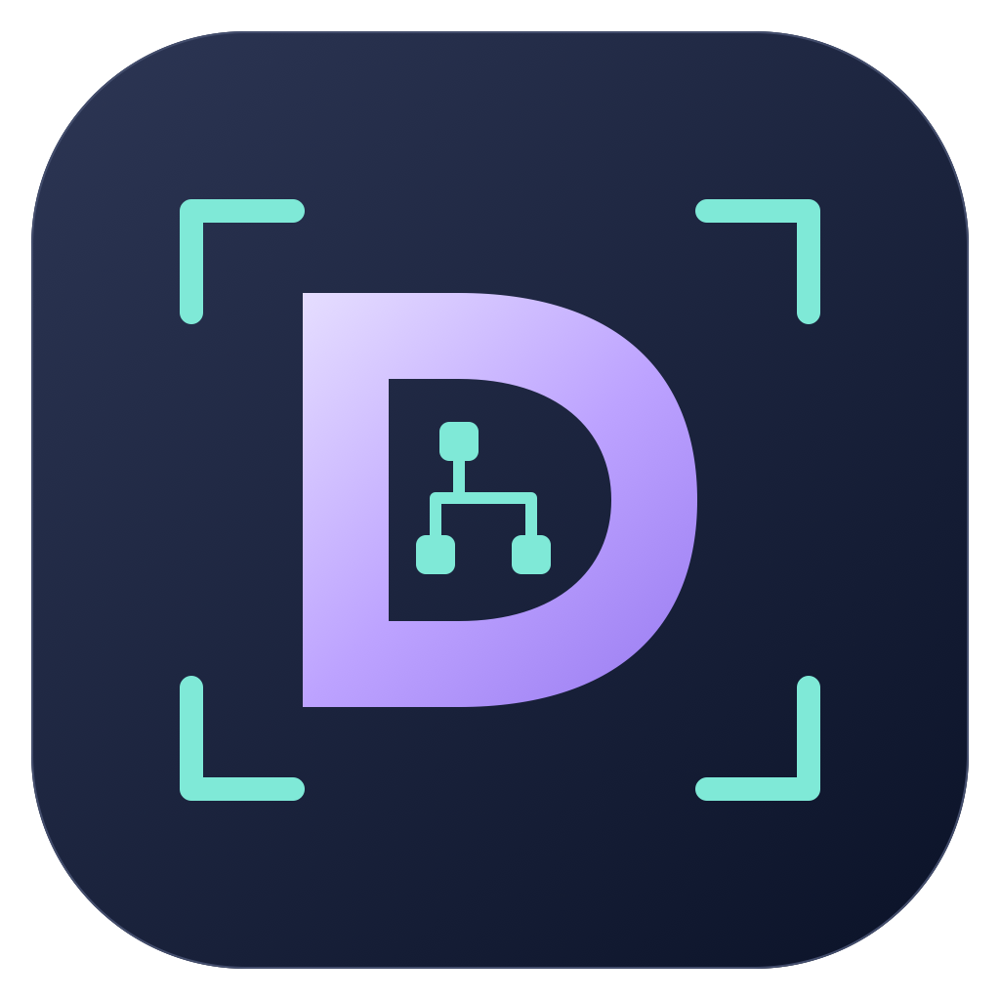

# DomScan

**指向界面，读懂 DOM。**

macOS 桌面前端元素选择器。可视化选择 Electron / Chromium，以及已接入 DomScanBridge 的 WKWebView 应用窗口，读取真实 HTML、计算样式和 iframe 上下文，添加修改说明后交给 AI 或用于本地开发排查。

当前版本：**0.4.0** · macOS 14+ · 交付安装包为 Apple Silicon。

## 功能

- 点选桌面窗口，或从正在运行的应用列表选择；自动寻找所属进程的本机检查接口。
- 识别标准 Electron 和改名的 Chromium 框架，不使用应用名称白名单。
- 未开放接口时，可另开独立检查实例；也可经确认后正常重启原应用并保留启动参数。
- 悬停高亮、点击选择、Shift 多选，支持父级、子级及相邻元素导航。
- 捕获 HTML、文本、计算样式、元素尺寸、稳定选择器和 frame 路径。
- 支持同源、跨域、跨进程、嵌套及动态 iframe，以及开放的 Shadow DOM。
- 逐元素备注，复制 Markdown 上下文，导出 Markdown / JSON。
- Esc 暂停拾取并恢复正常点击和输入；连接意外丢失后自动释放拾取事件。
- 应用启动时等待实际 HTML 页面，窗口列表自动刷新。
- WKWebView 开发桥接：原生 Swift 显式接入，或自动观察 Flutter macOS 的窗口视图树；只在 Debug 构建启用。

## 下载与使用

从 [Releases](https://github.com/Shea0116/DomScan/releases) 下载最新 macOS 安装包，解压后运行 **DomScan.app**。

当前构建使用临时签名，尚未进行 Developer ID 公证。

1. 选择应用或点击 **“点选窗口”**。
2. 已开放检查接口时直接连接；否则点击 **“打开独立检查实例”**。在新实例中操作和拾取，网页登录状态可能不同。
3. 应用包含多个前端窗口时，先从左侧选择目标窗口。
4. 点击 **“开始拾取”** 或按 **⇧⌘Z**，回到目标应用点击元素；按住 Shift 可多选。
5. 按 **Esc** 暂停，再回到 DomScan 填写备注并复制上下文。

窗口选择层可用 Esc、右键或“取消选择”退出，30 秒未选择会自动退出。常用流程无需填写端口。

若需接入原工作窗口，请先保存内容，再选择 **“重新打开原应用并连接…”**。部分 Chromium 发行版不允许在默认网页配置中开放调试接口，这时可使用独立实例。

## 本地桌面项目

适合 Electron / Chromium 桌面项目。先启动开发项目，在开发配置中开放本机远程调试接口，再从 DomScan 选择该进程；这可以保留原开发入口和热更新环境。手动连接地址位于“高级连接”。

WKWebView / Flutter macOS 项目使用本地 Swift Package `Bridge/`。接入后正常启动项目，从 DomScan 可视化选择，无需填写端口。详见 [WKWebView 接入说明](Docs/WKWebView.md)，其中包含 Flutter Runner 的接入步骤及首次页面重新加载要求。

DomScan 捕获的是运行时 DOM。复制的 HTML、属性、文本和 frame 路径可以帮助在项目中搜索对应组件，但当前不提供源码文件、行号、React / Vue 组件调用栈或 source map 映射。断点和单步调试仍需 DevTools / IDE。

## 范围与数据

- 接入层包括 **Chromium / Electron CDP** 和 **WKWebView 开发桥接**。未接入桥接的第三方 WKWebView 应用、纯原生控件和 Flutter 原生控件无法读取 HTML；当前没有 Tauri 专用接入适配器。仅开启 Safari 的 `isInspectable` 不足以连接 DomScan。
- 仅连接本机地址；不使用截图或 OCR 推断元素。
- iframe 必须属于可接入目标；支持开放 Shadow DOM，不保证读取关闭 Shadow DOM、Canvas / WebGL 内部内容。
- 元素尺寸使用 frame 内 CSS 像素坐标。CDP 导出包含 frame 祖先路径；WKWebView 公开 API 不提供完整祖先树，导出仅包含当前 frame 的 UUID 和 URL，并在界面提示此限制。
- 导出为采集时的静态上下文：HTML 最多 16,000 字符，文本最多 2,400 字符。输入框当前值不作为采集字段。
- 采集结果保存在内存中，由用户复制或保存。应用不内置 AI 上传接口。
- 独立实例使用单独的 Chromium 网页配置，不复制原窗口的 Cookie 或历史；应用自行管理的原生配置、钥匙串或 CLI 登录状态仍可能共用。
- 新配置位于 `~/Library/Application Support/DomScan/Inspection Profiles/`。升级时可继续使用旧版 Desktop Selector 的已有配置，避免移动运行中的应用文件。

## 构建

需要 Xcode / Command Line Tools 和 [RTK](https://github.com/rtk-ai/rtk)。应用运行时不需要 Python、Node.js、npm 或 RTK。

```sh
rtk proxy zsh scripts/build.sh
# 或指定输出目录
rtk proxy zsh scripts/build.sh /absolute/output/directory
```

按当前机器架构构建 `DomScan.app`，并进行临时签名。图标已包含在仓库中，常规构建无需重新生成。

## Logo

紫色 **D** 代表 DomScan，薄荷绿扫描框表示定位，内部的三个节点表示 DOM 树。

可编辑 SVG、透明 PNG 和应用图标预览位于 [assets/](assets/)。macOS 图标位于 `Resources/AppIcon.icns`，应用内图标位于 `Resources/BrandMark.png`。

```sh
rtk proxy xcrun swift scripts/make-icon.swift .
```

## 验证

测试使用本地页面和临时应用配置。运行测试需要另行安装对应宿主；这些依赖不属于应用运行依赖。

- `Tests/Integration.swift`：真实 DOM、CSS、跨进程 / 嵌套 / 动态 iframe、选择事件隔离、Esc 后输入恢复及掉线释放。
- `Tests/EngineEntryIntegration.swift`：改名框架识别、空白启动页处理、按 PID 连接和窗口元数据刷新。
- `Tests/InspectionLaunchIntegration.swift`：独立实例启动、保留原实例及重复连接复用。
- `Tests/PickerLifecycle.swift`：选择层焦点、超时、重复取消和失焦清理。
- `Tests/VSCodeFixture/`：隔离 VS Code 开发窗口中的真实桌面 WebView 测试扩展。
- `Tests/WKWebViewIntegration.swift`：真实 WebKit DOM、跨域 / 嵌套 / 动态 frame、独立脚本世界、鉴权、导航、Esc、断线及重新连接。

WKWebView 回归使用系统 WebKit，无需安装浏览器；测试脚本自行启动并清理本地网页服务器，9471 / 9472 端口需空闲：

```sh
rtk proxy zsh scripts/test-webkit.sh
rtk proxy zsh scripts/test-webkit.sh "$PWD/work/webkit-observe" observe
rtk proxy zsh scripts/test-webkit.sh "$PWD/work/webkit-sandbox" observe-sandbox
```

基础 CDP 回归：

```sh
rtk proxy python3 Tests/fixture_server.py
# 在另一个终端运行独立 Electron 测试宿主
rtk proxy electron Tests/electron-main.cjs
rtk proxy zsh scripts/test.sh http://127.0.0.1:9445 /absolute/report-directory
```

改名 Chromium 与独立启动回归使用本机 `/Applications/ChatGPT.app`，需要 Python 3、`websockets` Python 包和空闲的 9471 / 9472 端口：

```sh
rtk proxy zsh scripts/test-renamed-engine.sh /absolute/report-directory
```

该回归仅关闭自己创建的 `/private/tmp/ds-engine.*` 和 `/private/tmp/ds-launch.*` 实例，不重启日常应用。测试窗口会导航到本地 HTML 页面，不重签宿主、不注入动态库、不关闭 CSP。报告和采集样例仅写入指定报告目录。

`Tests/*validation.txt` 为历史验证记录，各自保留当时的版本和范围。

## 源码结构

```text
Sources/
  DomScanApp.swift           SwiftUI 界面、菜单栏与快捷键
  ApplicationConnector.swift 应用发现、独立实例与重启接入
  DesktopWindowPicker.swift  系统窗口点选与取消
  CDP.swift                  本机端点、WebSocket、CDP 消息
  WebKitConnection.swift     WKWebView 端点发现、鉴权与通信
  CaptureSession.swift       frame 生命周期、选择、备注及导出
  ConnectionSidebar.swift    应用和前端窗口列表
Resources/
  picker.js                  指向桥接包内共享 DOM 选择器的符号链接
  Info.plist                 应用包配置
  AppIcon.icns               macOS 应用图标
assets/                      品牌 SVG / PNG
Bridge/                      可接入目标应用的本地 Swift Package
Docs/WKWebView.md             Swift / Flutter 接入说明
scripts/                     构建、图标生成及回归入口
Tests/                       测试宿主与集成检查
```

## 版本

**0.4.0**：加入 WKWebView Debug 桥接、Flutter 窗口视图自动发现、跨域和嵌套 frame 拾取；全局快捷键改为 ⇧⌘Z。

**0.3.1 · DomScan**：应用、窗口、导出及安装包统一更名；加入原创 SVG / PNG / ICNS 标志；兼容旧检查配置。DOM 接入能力沿用 0.3 系列。
